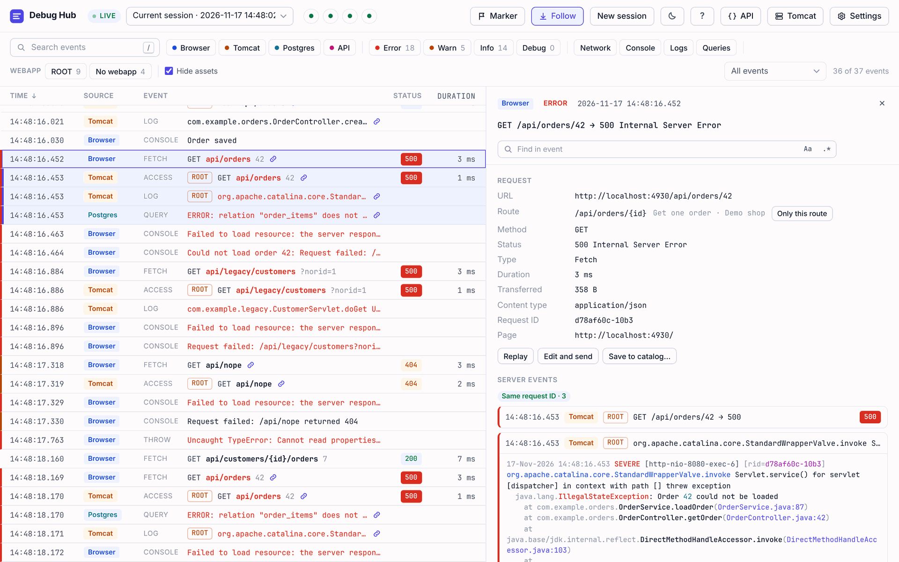
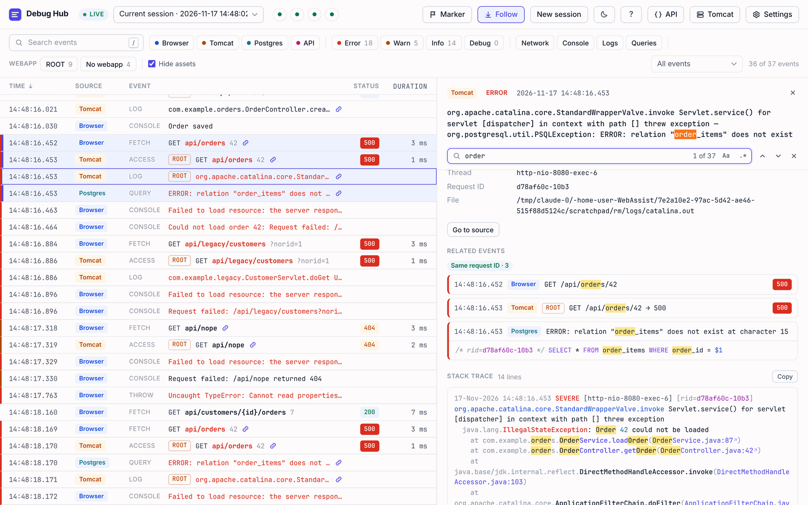
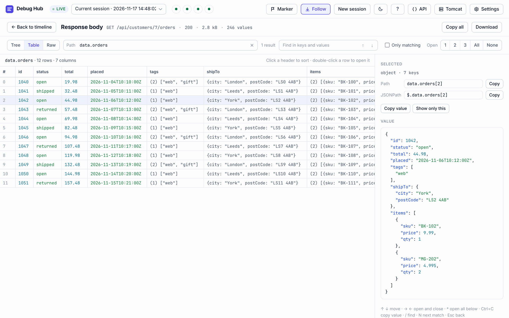
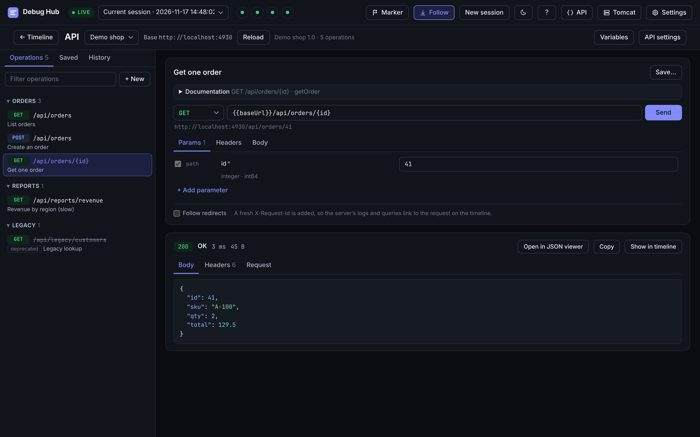
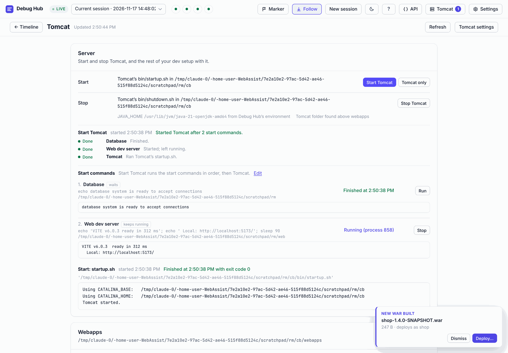
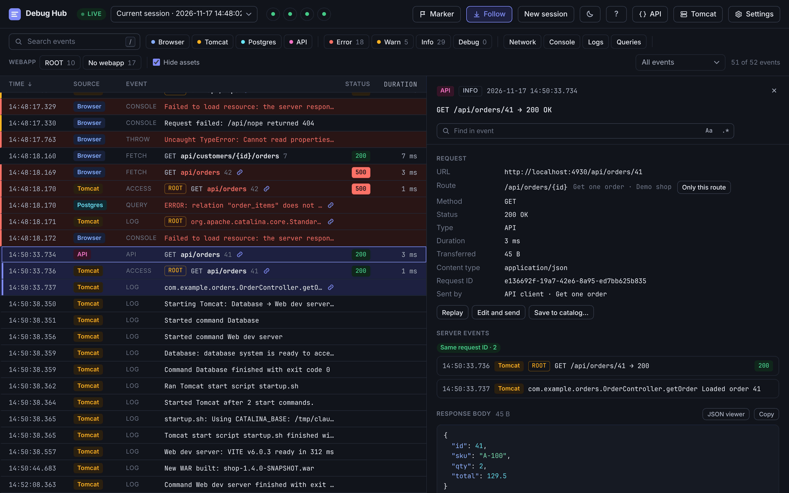
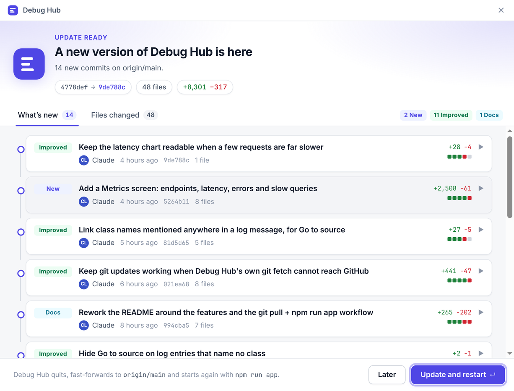

# Debug Hub

One timeline for everything that happens while you develop a Java web app locally: the
browser's console and network traffic from Chrome, Tomcat's application and access logs, and
Postgres slow queries and errors. Select a failed request and the log lines, stack trace and
SQL it caused appear beside it. From there you can open the code in your editor, explore the
JSON, replay the request, and redeploy the WAR you just built.

Everything runs on your machine. The hub binds to `127.0.0.1` and sends nothing anywhere.



## What it does

**One timeline, linked by request.** Chrome (attached over the DevTools protocol, alongside
IntelliJ's debugger), Tomcat logs and Postgres logs are recorded into one session. When a
request carries an ID (`X-Request-Id`), the server events it caused are listed under it;
without one, they are matched by path and time. Network rows read as routes, `api/orders 42`
rather than `/api/orders/42`, and Tomcat rows carry the webapp they came from, with a filter
for each.

**Find and go to source.** A find bar searches everything about the selected event, bodies
included. Stack frames, loggers and exceptions from your own code become links that open the
file at the line in VS Code, IntelliJ IDEA, Emacs or Neovim (a running nvim is reused).



**JSON viewer.** Response and request bodies open full-window as a tree, a table or
highlighted text. The Path box completes paths from the document itself and finds nested ones
(`price` offers `data.orders[*].items[*].price`); the table shows any array, with nested values
summarised in each cell.



**API client.** Load your OpenAPI or Swagger spec and call any endpoint: parameters and an
example body come from the spec, requests are sent by the hub (no CORS), and each one lands on
the timeline with the server events it caused. Save requests in a catalog with `{{variables}}`,
and replay or edit any request the browser made.



**Metrics.** How often each endpoint is hit, how fast it answers (p50, p95, max) and how often it
fails, over the whole session or the last few minutes, with the exceptions, log errors, Postgres
errors, console errors and slow queries grouped beside them. Click a row to see those requests or
that error on the timeline.

**Tomcat control.** Start your whole dev setup with one button (database, dev server, then
Tomcat, with your scripts or Tomcat's own `startup`), start, stop, disable and delete
webapps, and get a notice when a WAR finishes building, with a one-click deploy that keeps your
local `config.yaml`, `config.js` and `log4j2.xml`, tells you which settings the new build adds
to them, and merges the two side by side. WARs that are built elsewhere come from package
registries (Nexus, Artifactory, any Maven repository, a CI server's URL): new versions are
announced the same way, and any version can be downloaded and deployed.



**Light and dark.** Every screen has both themes.



## Getting started

You need [Git](https://git-scm.com/), [Node.js](https://nodejs.org/) 18 or later, and Chrome.
Then:

```
git clone https://github.com/PeytonSch/WebAssist.git
cd WebAssist
npm install
npm run app
```

`npm run app` builds Debug Hub and opens it as a desktop app. The first time, it opens the
**setup guide**: it asks what you work with (Chrome, Tomcat, Postgres, your editor, REST APIs),
then takes you through only those settings, one step at a time, saying what each one does, what a
value looks like and whether you need it. It looks for Tomcat (including the run folders
IntelliJ IDEA makes), Postgres logs, JDKs and built WARs in the usual places and offers what it
finds, and nothing is saved until the last step. Open it again any time from the top of
**Settings** (File → Settings…, or `Ctrl+,`).

Settings itself has every option in one page. Each section says what it needs and shows what it
finds as you type:

- **Browser**: press **Start Chrome**. Chrome opens with a debugging port and a profile of its
  own, and the timeline starts filling as you use your app in it.
- **Tomcat**: the logs folder (usually `CATALINA_BASE/logs`). Under **Tomcat server**: the
  `webapps` folder, the folders your WARs are built in, and optionally start and stop scripts
  and start commands.
- **Postgres**: the server log, for slow queries, plans and errors.
- **API client**: your OpenAPI spec URL, e.g. `http://localhost:8080/v3/api-docs`.
- **Source code**: your editor.

Not sure where things are? `npm run doctor -- --project /path/to/your/app` inspects the running
Chrome, Tomcat and Postgres and prints what it finds (see `docs/environment.md`).

### Keeping it up to date

Run this way, Debug Hub keeps itself up to date with `main`. It checks for new commits when it
starts (on the splash screen) and every 5 minutes, and shows what is new in its update window:
each commit with its message and files, and every changed file with its diff. On **Update and
restart** it runs `git pull`, then `npm install` if the dependencies changed, then `npm run app`
again.
**File → Check for Updates…** checks now. It leaves the update to you when the checkout is on
another branch or has changes of its own; then it is the usual:

```
git pull
npm install        # when package.json changed
npm run app
```



Details, and how to turn it off: [docs/updates.md](docs/updates.md).

### Try it without your stack

The repository has a stand-in app that writes Tomcat- and Postgres-format logs, serves an
OpenAPI spec, and has buttons for a 500 error, a slow query and the like. In two terminals:

```
npm run demo        # the stand-in app on http://localhost:4010
npm run demo:hub    # Debug Hub in the browser, on http://localhost:4000, set up for the demo
```

Open http://localhost:4000, click **Start Chrome**, open http://localhost:4010 in the Chrome
window that appears and click the buttons.

### Other ways to run it

- **In a browser tab:** `npm start` serves the same UI on http://localhost:4000 without the
  desktop app. It reads `debug-hub.config.json` from the folder you start it in (or
  `--config <file>`); the desktop app keeps its settings in its user-data folder instead
  (File → Open Config File).
- **Installers:** a release build installs like any app (Windows installer, macOS `.dmg`) and
  updates itself from GitHub Releases rather than from git. See
  [docs/updates.md](docs/updates.md).
- **Inside Tomcat:** `npm run build:war` builds `dist/debug-hub.war`. Drop it into a Tomcat's
  `webapps` folder and open `http://localhost:8080/debug-hub/`: Debug Hub then already knows
  that Tomcat's folders. See [Running inside Tomcat](#running-inside-tomcat).

On Windows the desktop app draws its own title bar in its theme: the ☰ button at the top left
opens the menu, and the top bar drags the window (double-click to maximize).

## The timeline

- Filter by source, level and kind; shift-click a filter to show only that one. Search matches
  URLs, messages, bodies, request IDs and webapp names.
- Tomcat rows show their webapp next to the event. Once there are labelled events, a Webapp
  filter appears (a menu when there are more than three choices) that hides Tomcat events of
  webapps you are not working on; "No webapp" covers Tomcat events without a label. It does not
  affect browser or Postgres events, and is saved with filter presets.
- "Hide assets" hides scripts, styles, images and fonts unless they failed.
- Select a row for details. For a browser request the panel shows the server events that
  share its request ID, or, when there is no ID, events matched by path and time (labelled as
  such).
- Click the Time column header (or press `O`) to show the newest events at the top instead
  of the bottom. Follow then keeps the top of the list in view. The choice is remembered.
- The find bar at the top of the detail panel searches the selected event: its title, facts,
  related events, headers, request and response bodies (all of a large body, not only the part
  on screen) and the raw event JSON. Press `Ctrl+F` (`Cmd+F` on a Mac) to jump to it; `Enter`
  / `Shift+Enter` or `F3` / `Shift+F3` move between matches, which are highlighted, and `Esc`
  clears it. `Aa` makes it case-sensitive and `.*` takes a regular expression. The query stays
  when you select another event, so you can step through events looking for the same text.
- Network rows show the request's **route** in bold, with the parts that vary muted after it:
  `/user/id/12345?x=1` reads as **user/id** `12345 ?x=1`, so calls to the same endpoint are easy
  to spot. Numbers, UUIDs, long hex strings, dates and long tokens count as IDs; an ID in the
  middle shows as `orders/{id}/items`. When an OpenAPI spec is set up for the API client, its
  path templates are used instead (which also catches IDs that look like words, such as a user
  name), and the tooltip names the operation. Search `route:user/id` for every request with that
  route, or `route:/user/id/{id}` for one exact template; **Only this route** in the detail panel
  does the latter. **Highlight** beside it picks a colour for the route (eight that read on both
  themes, or any colour): its requests, from the browser, the API client and Tomcat's access log,
  are tinted in it with a bar at the edge, so they stand out as they come in. The picker also
  lists the other highlighted routes, to remove them. Highlights are kept in this browser.
- A request's details start with **Response body in JSON viewer** (and **Request body**, when
  that is JSON), above Find in event, so a body opens without scrolling down to it; a body that
  is not JSON gets a button that scrolls to it. **Compare…** puts the response body in the JSON
  compare view.
- The session menu switches between the live session and saved ones.
- Shortcuts: `/` search, `M` marker, `J`/`K` or arrows to move, `E` errors only, `F` follow,
  `O` newest/oldest first, `R` reset filters, `Ctrl+F` find in the selected event, `V` JSON
  viewer, `G` go to source, `S` metrics, `Esc` close, `?` help.

## Metrics

**Metrics** in the top bar (or `S`) opens a summary of the session on the timeline, live or
saved. It updates as events arrive.

- **Which requests count.** The same request is usually recorded twice, by the browser and in
  Tomcat's access log. *Server* counts the access log (every client, timed by Tomcat); *Browser +
  API* counts what Chrome and the API screen sent (timed as they saw it, including the network).
  Server is the default once there are access-log requests; nothing is counted twice. *Include
  assets* adds scripts, styles, images and fonts (failed ones always count).
- **Time range:** the whole session or the last 5, 15 or 60 minutes. Drag across the requests
  chart to zoom into a window; `Esc` or the ✕ on its chip goes back.
- **Tiles:** requests, requests per minute, error rate (4xx, 5xx and failed, out of answered
  requests), p50 and p95 latency, slow requests (1 s or more), Tomcat log errors, exceptions,
  slow queries and console errors.
- **Charts:** requests over time by outcome, and p50 / p95 latency with the slowest request of an
  interval marked where it stands above p95. Hover or focus a chart (then `←` `→`) for the
  numbers; **Table** shows them as a table.
- **Endpoints:** one row per method and route (the same routes as the timeline, using your
  OpenAPI templates when a spec is set up) with count, errors, error rate, p50 / p95 / max,
  average size, last seen and a trend. Sort by any column, filter by name, and click a row to
  show its requests on the timeline (`route:` search).
- **Breakdowns:** status codes, requests per webapp, and *server vs browser time*: for requests
  both sides saw (matched by request ID), how much of the browser's time was the server's and
  how much was network, proxy and browser.
- **Errors:** exceptions by class, message and root cause; Tomcat warnings and errors by logger;
  Postgres errors and console errors by message. **Slow queries** groups the statements Postgres
  logged with a duration, with literals and the request-ID comment taken out, by total time.
  Click any row to select its latest occurrence on the timeline.

## Go to source

Java classes in Tomcat log entries open in your editor at the line: stack frames from your own
code, the logger (shown under Log entry), exception classes, and fully qualified class names
anywhere in the message (`Registered bean of type com.example.orders.OrderService`) become
links (underlined on hover, with a small ↗). Click one, or focus it with `Tab` and press `Enter`. **Go to source**
under the log entry (or `G`) opens the top frame from your code, else the logger's class. Library
frames stay plain. When two projects or modules define the same class, the one whose WAR the
event's webapp was deployed from is used; otherwise a dialog asks which.

Set it up under Settings → Source code:

- **Editor**: VS Code, IntelliJ IDEA, Emacs (through `emacsclient`, so the Emacs server must be
  running: `M-x server-start`), Neovim, or a custom command. The program is found on `PATH` and
  in the usual install places (shown under the setting); give its path if it is elsewhere.
- **Neovim**: with "Use a running nvim" on, the file opens in an nvim that is already running
  (Neovim 0.9+ always listens on an address of its own: a named pipe on Windows, a socket in
  `$XDG_RUNTIME_DIR` or the temp folder elsewhere), preferring one whose working folder is in the
  project, else the most recently started; it works from insert or terminal mode too. It cannot
  bring that terminal window to the front. Without one, nvim starts in a new terminal window:
  pick WezTerm, Windows Terminal or another preset, or write your own command (below).
- **Where the sources are**: each WAR build folder (`tomcat.warWatch`) leads to its project by
  walking up to the folder with `pom.xml`, `build.gradle(.kts)` or `settings.gradle(.kts)` (the
  outermost within four levels, stopping at a `.git` folder), so `C:/dev/*/target` covers every
  project there. Add other projects (a shared library) under "More project folders". Every
  `src/<set>/java`, `kotlin`, `groovy` and `scala` folder in every module is indexed in the
  background; new and removed files are picked up within about 10 seconds. "Projects found"
  lists what was found, with class counts.

Commands (the terminal for Neovim and the custom editor) are split into arguments by spaces,
with `"…"` or `'…'` grouping, and run without a shell, so a path is never read as shell syntax.
Placeholders: `{file}`, `{line}`, `{column}`, `{dir}` (the project folder) and, for the terminal,
`{cmd}` (`nvim +<line> <file>` as separate arguments). Placed inside a quoted argument that has
spaces, i.e. a command line for another program as in `wezterm start -- nu -c "nvim +{line}
{file}"`, a value with spaces is quoted for that program: in single quotes on macOS and Linux;
on Windows with forward slashes in double quotes (`"C:/dev/my shop/Foo.java"`), which cmd,
PowerShell and nushell all read the same way.

On Windows, programs are started directly: VS Code as the `Code.exe` that `code.cmd` wraps (with
`--goto file:line:column`), IntelliJ IDEA as `idea64.exe --line N file` (also the one a JetBrains
Toolbox `idea.cmd` starts), `emacsclient.exe -n +line:column file`, `nvim.exe --server
\\.\pipe\nvim.<pid>.0 --remote-send …`. Any other `.cmd` or `.bat` runs through `cmd.exe /d
/v:off /s /c` with every argument quoted; a file path containing `"` or `%` is refused there.
Only files in the index are opened: the API takes a class name, never a path.

## JSON viewer

JSON response and request bodies, the raw event, and console or log messages that contain a
JSON object get a **JSON viewer** button in the detail panel (or press `V` with the event
selected). It opens full-window over the timeline; `Esc` or **Back** returns to the same event.

- **Tree**: open and close objects and arrays with the mouse or the arrow keys (`*` opens
  everything below), or open 1, 2, 3 or all levels at once. Large bodies stay quick: only the
  rows on screen are drawn.
- **Selected value**: its path as `data.items[3].price` and as JSONPath `$.data.items[3].price`,
  with Copy buttons, plus Copy value (as JSON) and the whole value. A string that holds JSON
  can be opened as JSON in its own view.
- **Find** searches keys and values; `Enter` / `Shift+Enter` step through the matches, and
  "Only matching" hides the branches without one.
- **Path** shows part of the document: `data.items`, `items[0].name`, `items[*].price`,
  `items[-1]`, `items[1:3]`, `..id` (any depth), `["a-b"]`, and filters such as
  `items[?(@.price > 10 && @.status == "open")]`. Copied paths can be pasted back in.
  As you type it suggests what can come next from the document itself: the keys at that point,
  `[*]` / `[0]` / `[-1]` for arrays and the keys of their items, and matching keys further down,
  so `price` typed at the top offers `data.orders[*].items[*].price` and `..price`. `↑` `↓` choose,
  `Tab` or `Enter` take one, `Esc` closes the list. A path that finds nothing from the top is
  looked for at any depth instead (`address.city` finds `data.customer.address.city`), and the
  status says so. `Ctrl+L` (`Cmd+L` on a Mac) or `P` puts the caret in Path.
- **Compare…** opens the JSON compare view with this document on the left (see below).
- **Table** shows any array (by default the Path result, the selected one, or the first array
  of objects in the body): objects get a column per key, arrays a column per position (`[0]`,
  `[1]`…), plain values a value column. A Path with several arrays, like `orders[*].items`,
  puts all their items in one table, each labelled with its path; an object with no array in it
  shows its keys and values. Nested objects and arrays show what is in them on one line, e.g.
  `{city: "York", postCode: "LS0"}` or `(2) [{sku: "S-0", price: 9.99}, …]`; hover for the whole
  value, click to open it. Click a header to sort.
- **Raw** is the pretty-printed text. Copy all and Download save the JSON.

Numbers are shown exactly as sent, so 64-bit IDs are not rounded (they are marked "big").
When a body was cut off at the body size limit, the viewer shows what was captured, says so,
and marks the values that were cut off; raise "Body size limit" in Settings to capture more.
Text that is not valid JSON is shown as captured, with the position of the error marked.


### JSON compare

**Compare…** in the JSON viewer or a request's details opens two JSON documents side by side,
read-only. The other side is pasted, or loaded from the recent response and request bodies on
the timeline or the documents opened in the JSON viewer; `Ctrl+Enter` compares. Both are
pretty-printed the same way, with keys sorted (**Sort keys**, on by default), so formatting
and key order are not differences. Changed lines are marked, and inside them the words that
differ; **Only changes** folds away unchanged stretches (a click opens one). On the left, every
value that differs is listed by path (`$.items[6].price: 25.5 → 99`, added, removed); a click
shows it. Array items are matched up, so one inserted at the front is one addition. `N` / `P`
(or the arrows) step through the differences. A side that is not valid JSON is compared as
text.

## API client

The **API** button in the top bar (or `#api`) opens a screen for calling your REST endpoints
directly, and seeing what each call did on the server.

- **Specs.** Add your OpenAPI 3.0/3.1 or Swagger 2.0 spec under Settings → API client: a URL
  (Spring's springdoc serves it at `/v3/api-docs`, springfox at `/v2/api-docs`) or a file.
  JSON is read as is; YAML through a small built-in reader that covers what specs use (block
  maps and lists, quoted and block text, `[ ]` and `{ }`) and names the line of anything else
  (anchors and aliases are not supported). **Load specs** in Settings checks each one. The
  spec's operations are listed by tag, with their parameters, request body and responses;
  `$ref`s within the spec are followed (references to other files are not). The server URL
  comes from the spec (`servers`, or Swagger 2's `schemes`/`host`/`basePath`; relative ones
  are resolved against the spec's URL) unless **Base URL** is set. Default headers are sent
  when fetching a spec only from this machine or the base URL's host.
- **Requests.** Pick an operation, or **+ New** for a request without a spec. The builder fills
  in path, query, header and cookie parameters with the spec's examples (optional ones start
  switched off; typing a value switches them on; enums become a menu), shows the default
  headers from Settings (each can be turned off for the request, or overridden), and can
  generate an example JSON body from the schema (`readOnly` properties are left out). A JSON
  object body is form-encoded when the content type is `application/x-www-form-urlencoded`.
  The URL line shows the URL as it will be sent. **Send** (`Ctrl+Enter`) sends it; **Cancel**
  stops it. The values last used for each operation are remembered in the browser.
- **How it is sent.** The hub sends the request itself, so CORS does not apply and any local
  service can be reached. Redirects are returned as they are unless **Follow redirects** is on.
  With `api.addRequestId` on, the request carries `correlation.header` with a fresh ID, so the
  Tomcat log lines and queries it causes are linked to it on the timeline. Proxy variables
  (`HTTP_PROXY`) are not used.
- **Response.** Status, time, size, headers and the body (pretty-printed and highlighted;
  binary bodies are not shown; up to 10 MB). **Show in timeline** closes the screen and selects
  the request on the timeline, with its server events.
- **On the timeline**, API requests are their own source (**API**), recorded like browser
  requests: a request and its response, headers redacted per `redact.headers`, bodies cut at
  `maxBodyBytes`.
- **Saved requests.** **Save** puts the request in a catalog, with a name, a folder and a
  description; the **Saved** list groups them by folder, and each can be sent at once (▶),
  renamed or moved, duplicated or deleted. A request built from the spec is saved with
  `{{baseUrl}}`, so it still works when the base URL changes. The catalog is
  `api-requests.json` next to the settings file, so it can be backed up or put in git;
  **Export** downloads it and **Import** merges a file into it (by id; variables by name) and
  says what changed. An unreadable file is renamed aside, not overwritten.
- **Variables.** `{{name}}` in a URL, parameter, header or body is filled in from
  **Variables** (stored in the same file); `{{baseUrl}}` is built in. A request with an
  unknown variable is not sent; the screen says which.
- **History.** The last 50 sends are listed under **History** and can be opened again. They
  are kept in the browser's local storage with the request's own headers, but not the default
  headers from Settings.
- **Recorded requests.** A browser (or API) request on the timeline offers **Replay** (send it
  again now, through the hub, and select the new one), **Edit and send** (open it in the
  builder) and **Save to catalog…**. Headers that cannot or should not be sent again are left
  out (`Host`, `Content-Length`, `Connection`, `Accept-Encoding`, `sec-ch-*`, `sec-fetch-*`,
  HTTP/2 pseudo-headers, the old request ID). A header redacted when it was recorded is sent
  from the default headers if one has that name, and otherwise becomes `{{header-name}}`,
  e.g. `{{authorization}}`, to fill in under Variables; Replay says so rather than sending
  `[redacted]`. A body cut off at `maxBodyBytes` when recorded cannot be replayed. Chrome does
  not report cookies with the request, so a cookie-based session has to be given as a
  `Cookie` header.
- **JSON viewer.** **Open in JSON viewer** opens a JSON response in the full JSON viewer; `Esc`
  comes back to the API screen.

**Plain text:** default headers (`debug-hub.config.json`) and saved requests and variables
(`api-requests.json`) are stored unencrypted. Keep real credentials out of files you share.

## Tomcat page and WAR deploys

The **Tomcat** button in the top bar (or `#tomcat`) opens a page for running Tomcat from Debug
Hub. Set it up under Settings → Tomcat server; the page says what is missing.

- **Server.** Start Tomcat and Stop Tomcat run your own scripts, in the script's folder, or
  without them Tomcat's own `bin/catalina.bat run` and `bin/shutdown.bat` (`.sh` elsewhere):
  with `CATALINA_HOME` set to the Tomcat folder (by default the folder above `webapps`),
  `CATALINA_BASE` to the folder above `webapps` when that has a `conf` folder, and `JAVA_HOME`
  to the Java folder if one is set. `catalina run` keeps Tomcat in the foreground, without a
  console window of its own: what it prints is in the **Console** below. The page says which
  way each button runs and what is missing (on Windows, `catalina.bat` needs `JAVA_HOME` or
  `JRE_HOME`). The output also goes on the timeline as Tomcat events (Tomcat's own log records
  only when its log files are not already followed). Debug Hub does not wait for the script,
  and Tomcat keeps running when Debug Hub closes.
- **Restart** (beside Stop) runs Stop, waits until Tomcat has stopped (its process ends, or,
  for a Tomcat started some other way, the Manager stops answering), ends it if it has not
  stopped within a minute, and starts Tomcat again, without the start commands or Chrome.
- **Console.** Tomcat's output like a terminal, with a tab each for Tomcat, its shutdown and
  the start commands: Tomcat's log records coloured by level, errors and stack traces marked,
  ANSI colours shown. **Wrap**, **Copy** and **Clear**; scrolled up, new output waits under
  **Latest output**. The console can be made taller by dragging its corner. **End process**
  ends a Tomcat that Stop does not get to stop. After Debug Hub restarts (an update), the
  output of a Tomcat started before it is still shown.
- **Sections fold.** Each section's title folds it away (remembered); Webapps, Disabled webapps
  and WAR builds show how many they hold beside the title. A webapp being started, stopped or
  reloaded shows a spinner beside its buttons until it is done.
- **Search.** Webapps, Disabled webapps, WAR builds and Packages each have a filter field:
  every word typed must appear in a row's name, path, state or (for packages) coordinates,
  registry and deploy-as name. The count beside the title becomes "3 of 12"; Esc clears the
  field. Packages also has **Hide N with no matching version**, which leaves out packages
  found in a registry none of whose versions pass the version settings (Versions, Version
  pattern), and the notes about them; it is remembered.
- **Start commands.** To bring up the whole dev setup at once, add start commands under
  Settings → Tomcat server. Start Tomcat runs them first, in order, then Tomcat, then Chrome if
  **Also start Chrome** is on. Each command runs in the system shell (`cmd.exe` on Windows,
  `/bin/sh` elsewhere) in its folder (empty: the settings file's folder), in the background
  without a window, so it keeps running when Debug Hub closes; its output goes on the timeline
  under its name and in the Console. A command
  marked **wait** must finish, with exit code 0, before the next step, within 5 minutes; if it
  fails or takes longer, the sequence stops and Tomcat is not started (a command that timed out
  is left running). Use it for what Tomcat needs first, e.g. `net start postgresql-x64-16`.
  Other commands are started and left running, e.g. `npm run dev` in the web project's folder;
  one still running from an earlier Start is not started again. The page shows each step's
  progress and each command's status and last lines of output; **Run** runs one command on its
  own and **Stop** ends it with everything it started (`taskkill /T` on Windows, its process
  group elsewhere). **Tomcat only** starts just Tomcat. A second Start while one is under way
  is refused.
- **Webapps.** Everything in `webapps`, as WAR and/or unpacked folder. With the Tomcat Manager
  set up (a user with the `manager-script` role in `conf/tomcat-users.xml`), each webapp shows
  whether it is running and can be started, stopped and reloaded in place. Without it, a
  webapp is either deployed or disabled.
- **Disable / Enable.** Disable moves a webapp's WAR and unpacked folder out of `webapps` into
  the disabled folder, so Tomcat undeploys it and forgets it; Enable moves it back. Nothing is
  ever overwritten. On Windows, a running Tomcat can keep files locked; the move is then undone
  and the message says to stop the webapp or the server first. With the Manager set up, a
  running webapp is stopped before it is moved.
- **Delete.** Deletes a webapp's WAR and unpacked folder for good, from `webapps` or the
  disabled folder, after a confirmation listing every path with its size. The WAR goes first
  (otherwise Tomcat would unpack it again). Links inside the webapp are removed, never followed.
  With the Manager set up, a running webapp is stopped first; files a running Tomcat still holds
  open are retried for a few seconds, then the message says exactly what was deleted and what is
  left. The Manager's `undeploy` is not used: it follows links inside the webapp folder and also
  deletes the webapp's context file in `conf/Catalina`.
- **WAR builds.** WARs in the watch folders are listed with when they were built. When a WAR
  is built or rebuilt while Debug Hub runs, a notice appears on every screen (and a desktop
  notification when the window is in the background, if allowed) once the file has stopped
  changing and is a complete archive. **Deploy** copies it into `webapps` under a temporary
  name and renames it to `<name>.war` when complete, so Tomcat never sees half a file; Tomcat
  (with `autoDeploy`, its default) deploys or redeploys it within seconds. The name is guessed
  from the file name, matching a deployed or disabled webapp, without a Maven version
  (`shop-1.4.0-SNAPSHOT.war` deploys as `shop`), and can be changed. Deploying over a disabled
  webapp brings it back with the new build and deletes the old disabled copy, unless you untick
  that. A webapp deployed as a folder without a WAR must be disabled before a WAR can replace
  it. **Show in Explorer** (Finder on macOS, the folder elsewhere) opens where a WAR was built.
- **Keeping local files.** If the copy being replaced (its unpacked folder, else its WAR, else
  its disabled copy) has files named in `tomcat.preserveFiles` anywhere in it (not under
  `WEB-INF/lib` or `node_modules`), the deploy dialog lists them under **Local config files**,
  each compared with the new build's file of the same path:
  - *The same as the new build's*, *only in the deployed copy*, or different. For a different
    file the dialog says what the build brings, by setting: `3 new settings in this build:
    mail.smtp.timeout, features.newSearch and cache (2)`, which settings the build no longer
    has, and how many values differ. Settings are read from YAML, JSON, `.properties`/INI and
    XML (element and attribute paths, e.g. `Loggers/Logger[com.shop]@level`), and as far as
    they can be made out from JavaScript config files (assignments and object literals); other
    files are compared by lines. Files with new settings come first and are marked.
  - Per file you choose **Keep deployed** (the default, as before), **Use new build**, or
    **Merge…**, which opens the merge view below; a merged file then shows as **Merged** and
    **Edit merge…** reopens it. **Keep all** and **Use new build for all** set every file.

  Kept and merged files are written into the new WAR before Tomcat sees it (replacing the
  build's file or added), so the webapp starts with your config. The build itself is not
  changed. ZIP64 (over 4 GB) and encrypted WARs cannot be rewritten; deploy those without
  keeping files.
- **Merging a config file.** The merge view shows three panes, as IntelliJ IDEA's merge window
  does: the **deployed copy** (yours, read-only), the **result** (editable; it starts as the
  deployed copy) and the **new build**'s file (read-only). Blocks are green where lines were
  added, blue where they changed (with the changed words marked) and grey where they were
  removed; ribbons join each block to its place in the next pane, and the three scroll together.
  The ribbons on the right are what the build has that the result does not; those on the left
  are what the deploy will change in your file.
  - **Add new settings from the build** takes every block that only adds lines and leaves your
    lines alone. That is the usual job: pick up new options, keep local values. A setting whose
    value differs is a block of its own, so one default can be taken without the rest. It works
    on lines, not on the file's structure: when the build's file is laid out very differently
    from yours, a new setting can land under the wrong parent. The format check below the panes
    says so before you apply.
  - In the gutter of the new build: **«** takes the block into the result (Alt+B), the middle
    button keeps your lines and adds the build's below (Alt+A), **✕** leaves the result as it is
    there (Alt+K). In the gutter of the deployed copy: **»** puts the deployed lines back
    (Alt+R). **Use deployed** and **Use new build** set the whole file. The shortcuts act on the
    current change: the one stepped to, or the one the caret is in.
  - **F7** / **Shift+F7** (and the arrow buttons) step through the changes; the counter reads
    `2 of 7 changes · 3 unresolved`, where unresolved are differences from the build neither
    taken nor set aside. The strip at the far right shows where the changes are; click it to
    go there. The chips under the toolbar list the new settings and tick them off as the result
    gets them; a click shows the setting.
  - The result is a text editor: type, select, cut and paste, Tab and Shift+Tab indent, Enter
    keeps the indentation, Ctrl+Z / Ctrl+Y undo and redo typing and buttons alike. It is
    compared again as you type, so the colours always show the result as it is. **Esc** leaves
    the editor for the next pane (Tab then reaches its buttons); Esc again closes, asking first
    if there are changes.
  - **Ignore whitespace** treats lines that differ only in spaces as the same; **Collapse
    unchanged** hides long stretches that are the same in all three (click one to open it).
  - **Apply** (Ctrl+Enter) hands the result to the deploy dialog. If it no longer reads as
    YAML, JSON or XML (or sets a key twice), that is shown while you edit and asked about on
    Apply, but not refused. The result is stored the way the deployed file is: its line endings
    (CRLF or LF), byte order mark and encoding (UTF-8, or ISO-8859-1 for files that are not
    UTF-8); the final line break is as you leave it.
  - Files over 1 MB or 20,000 lines, binary files and UTF-16 text are not merged: the dialog
    says why and offers Keep deployed and Use new build only. A deploy is refused (nothing is
    changed) if the deployed file or the WAR's file changed after the merge view read them;
    open the merge again.

  For scripts: `GET /api/tomcat/keep/compare?name=&file=` returns the comparison,
  `GET /api/tomcat/keep/file?name=&file=&path=` both texts, and `POST /api/tomcat/deploy`
  takes `merged: [{ path, text, deployedHash?, buildHash? }]` next to `keep: [paths]`. Only
  paths the search for kept files finds are accepted.

## Package registries

WARs that are not built on your machine can be deployed from a package registry. Add
registries under Settings → Package registries; the Tomcat page then has a **Packages** list
below the WAR builds. Three kinds of registry cover most setups:

| Kind | `type` | Use it for | How it finds versions |
|---|---|---|---|
| Maven repository | `maven` | Nexus 2 and 3, Artifactory, GitLab and GitHub package registries, a plain web folder: anything Maven itself can read. Give the repository's root URL and each package's group and artifact ID, or only a group ID to find every WAR in the group. | `maven-metadata.xml` next to the artifact; for a `-SNAPSHOT`, the metadata in its folder names the latest timestamped build. A group is read from the repository's folder listing (see below). |
| Nexus 3 search | `nexus3` | Finding every WAR in a Nexus Repository 3 repository without listing each one, and raw (non-Maven) repositories. Give the server's URL and a repository name. | `GET /service/rest/v1/search/assets`, all pages. For a large Maven repository, add `maven.extension=war` to the search's extra parameters so Nexus leaves out poms and jars. |
| Direct URL | `url` | One fixed address per WAR, e.g. a CI server's "last successful build" artifact. | A `HEAD` request (a `GET` for the first byte where `HEAD` is refused): a change in ETag, Last-Modified or size is a new build. |

- **Every WAR of a group.** Leave a Maven package's Artifact ID empty and Debug Hub finds the
  artifacts of the group by itself: it reads the group's folder listing, looks for a
  `maven-metadata.xml` in each folder, and keeps the artifacts whose newest version has a
  `.war` (or the extension and classifier the entry asks for), so libraries and the groups
  below are left out. Each is listed as a package of its own, and a new artifact turns up at
  the next check. `*` and `?` pick some of them (`shop-*`), as does a `/regular expression/`.
  This works where the repository lists its folders: Nexus 2, Nexus 3 (through its browse
  pages when the repository path itself does not list), Artifactory and a plain web folder.
  GitLab and GitHub package registries do not, so name each artifact there, or use a
  **Nexus 3 search**, which finds every WAR of a group too. Whether an artifact has a WAR is
  asked once per new version, so later checks cost one metadata request per artifact. A
  package named in its own entry keeps that entry's settings, even when a group search
  finds it too.
- **Login and transport.** Per registry: no login, a user name and password (Basic), a token
  (Bearer), and any extra headers (`X-JFrog-Art-Api`, `PRIVATE-TOKEN`, …). For a registry whose
  https certificate is signed by your company's own certificate authority, give that
  authority's certificate as a PEM file (`caFile`); **Allow untrusted certificates** accepts
  anything and is the last resort. Redirects are followed, and the login and extra headers are
  sent only to the host a request starts at, never to a host it is redirected to (blob storage
  behind the registry). HTTP proxies are not supported: the registry has to be reachable
  directly.
- **Secrets.** Logins are stored in `debug-hub.config.json` as plain text, like the Tomcat
  Manager password. To keep one out of the file, write `${env:NAME}` in its place (in a
  password, token, user name, header value or URL): Debug Hub reads the environment variable
  `NAME` of its own process when it starts, and the registry is listed with an error if it is
  not set. Passwords, tokens and header values are never written to the timeline, the state
  file or an error message.
- **Test connection** (in Settings, saved or not) tries the registry and says what it found
  for each package, e.g. `com.example:shop: 12 versions, latest 2.4.1`, or what is wrong: no
  login or a wrong one (401), not allowed (403), not found (404, with what to check), host
  not found, connection refused, timeout, an untrusted certificate, or a login page where a
  registry was expected. With no packages yet, a Nexus 3 lists its repositories.
- **Checking.** Each registry is checked when Debug Hub starts and then every
  `checkMinutes` (default 15; 0 turns automatic checks off), and with **Check now**. Versions
  are ordered as Maven orders them (`1.10` after `1.9`, `2.0-RC1` before `2.0`), and each
  package can be limited to releases or snapshots and to a version pattern (`2.*`, or a
  `/regular expression/`). What is there at the first check is taken as known. A version that
  appears later, or a SNAPSHOT or URL that is rebuilt, raises the same notice a freshly built
  WAR does, on every screen, once, also when it appeared while Debug Hub was not running.
  Dismiss it, or deploy it, and it is settled. Problems are shown per registry in the Packages
  list and noted on the timeline when they change.
- **Download & deploy.** Pick a version (the latest, or an older one to roll back) and the
  WAR is downloaded to `registry-cache/` next to the settings file, with progress and a
  Cancel. It is checked against the registry's checksum when there is one (the `.sha256`,
  `.sha1` or `.md5` file of a Maven repository, the checksum in a Nexus 3 search result) and
  must be a zip archive; a download that fails either check is deleted, not deployed. The
  ordinary deploy dialog then opens on the downloaded file, so the webapp name, a disabled
  copy and the files to keep work as for a local WAR.
- **Deploy as.** Each package shows the webapp name it deploys as (`→ shop`); click it to
  change it for that package, which is useful where one entry finds a whole group. The name
  is remembered in `registry-state.json`, as is a different name typed into the deploy
  dialog, and **Use default** forgets it. Without one, it is the entry's `deployAs`, else the
  package's name matched against the webapps there are. The Packages list shows what was last
  deployed from each package. Per package the three newest downloads and the deployed one are
  kept; older ones are deleted.
- **State.** `registry-state.json` next to the settings file remembers which versions have
  been seen, announced and deployed, and what is in the cache. Deleting it only makes every
  package start over as known.

Not covered: Artifactory's own search (AQL) and storage API (use its Maven layout), npm,
Docker and other non-WAR formats, proxies, and client certificates.

## Collectors

**Chrome.** Attaches to a running browser over CDP, and does not enable the Debugger domain,
so it runs alongside IntelliJ's JavaScript debugger. Records console messages, uncaught
exceptions, and requests with status, timing, headers and bodies. New tabs are attached as they
open. If Chrome restarts, the hub reconnects within about a second. The hub's own UI tab is
skipped.

Chrome has to be started with a debugging port **and a profile folder of its own**: Chrome 136
and later silently keep the port closed on the everyday profile, and a Chrome that is already
running on the profile you start takes the new window over and drops the flags. The easiest
way is the **Start Chrome** button (in the timeline while Chrome is not connected, on the
Chrome status pill in the top bar, and under Settings > Browser). It starts Chrome directly,
with `--remote-debugging-port=<chrome.port> --user-data-dir=<chrome.profileDir>`, does nothing
if Chrome already answers on the port, and says what went wrong if the port does not open.
Settings > Browser also shows the same command to run yourself (on Windows, for Command Prompt
and for PowerShell) with every path written out, so it can go into a shortcut or an IntelliJ
browser configuration.

**Tomcat logs folder.** With `tomcat.logsDir` set, every file in the folder is followed:
names containing `access_log` as access logs, everything else as application logs, and files
that appear later (the next day's logs) as they appear. Compressed archives and lock files are
skipped, and a file also listed under `appLogs` or `accessLogs` is left to that list. Old
rotated files cost almost nothing: files not written for an hour are only checked every few
seconds, and even with `tail.fromStart` files older than a day are not replayed.

**Tomcat application logs.** Follows the files, including date-rotated ones and truncation.
A line that starts with neither a timestamp nor a level is treated as a continuation, so a
stack trace is one event. Understands the Tomcat JUL layout, JUL's two-line default layout,
and common Logback, Log4j, Log4j2 and Spring Boot layouts, including level-first lines without
a timestamp (`DEBUG com.example.Foo - …`) that console appenders write into `catalina.out`.

**Webapp labels.** Each Tomcat log entry and access-log request is labelled with the webapp it
came from, where that can be told: by the log file's name (`shop.2026-11-16.log` is `shop`;
Tomcat's own `catalina`, `localhost` and `manager` logs name no webapp), by Tomcat's context
markers in the message (`in context with path [/shop]`, `Deploying web application directory
[…/webapps/shop]`), and for requests by their context path. Request paths are only matched
against webapps the hub knows: the contents of `tomcat.webappsDir` and `tomcat.disabledDir`
(or the `webapps` folder next to the logs folder), plus names seen in log file names and
deployment messages. `ROOT` is the `/` app.

**Tomcat access logs.** Parses the common pattern, and the extended pattern in
`docs/correlation.md` that adds duration and the request ID.

**Postgres.** Follows the server log. Slow statements and `auto_explain` plans become query
events with the SQL and plan separated; `DETAIL`, `HINT` and `STATEMENT` lines are folded
into the error above them.

## Configuration reference

The **Settings** screen edits everything below. Each log path shows which files it matches as
you type, and saving applies the change at once without a restart (except `port`). The desktop
app stores settings in `debug-hub.config.json` in its user-data folder (`%APPDATA%\Debug Hub`
on Windows; File → Open Config File); `npm start` uses that file in the folder it starts in,
or `--config <file>`. Keys added by hand are kept when Settings saves the file.

Relative paths are relative to the config file. Everything is optional. Windows paths can be
written with forward slashes or pasted as they are (`C:\Users\me\logs`).

| Key | Default | Meaning |
|---|---|---|
| `port` | `4000` | UI port. Also `--port`. |
| `sessionsDir` | `sessions` | Where session files are written. |
| `chrome.port` | `9222` | Chrome's remote debugging port. Also `--cdp-port`. |
| `chrome.profileDir` | `chrome-profile` | The `--user-data-dir` that **Start Chrome** uses. Must not be Chrome's everyday profile (see below). |
| `chrome.executable` | empty | Chrome for **Start Chrome**. Empty: the usual install locations (Program Files and `%LOCALAPPDATA%` on Windows, `/Applications` and `~/Applications` on macOS, `google-chrome`/`chromium` on `PATH` on Linux). |
| `chrome.captureBodies` | `true` | Capture text and JSON response bodies. |
| `chrome.bodyResourceTypes` | `XHR, Fetch, Document` | Resource types whose bodies are captured. |
| `tomcat.enabled` | `false` | Turn on the Tomcat collectors. |
| `tomcat.logsDir` | (empty) | A Tomcat logs folder, usually `CATALINA_BASE/logs`. Every log in it is followed; see below. |
| `tomcat.appLogs` | `[]` | Application logs outside the logs folder. `*` is allowed in the file name. |
| `tomcat.accessLogs` | `[]` | Access logs outside the logs folder. |
| `tomcat.accessDurationUnit` | `ms` | Unit of `%D`: `ms` up to Tomcat 9, `us` from Tomcat 10. |
| `tomcat.webappsDir` | (empty) | Tomcat's `webapps` folder, for the Tomcat page and WAR deploys. Its contents also name the webapps that events are labelled with. |
| `tomcat.disabledDir` | (empty) | Where disabled webapps are moved. Must be outside `webappsDir`. |
| `tomcat.startScript`, `tomcat.stopScript` | | Scripts run by Start Tomcat and Stop Tomcat (`.bat`, `.cmd`, `.ps1`, `.sh` or any program). Empty: Tomcat's own `bin/startup` and `bin/shutdown`. |
| `tomcat.home` | (empty) | `CATALINA_HOME`, for Tomcat's own scripts. Empty: the folder above `webappsDir`, if it has `bin`. |
| `tomcat.javaHome` | (empty) | `JAVA_HOME` for Tomcat's own scripts. Empty: Debug Hub's environment. |
| `tomcat.startCommands` | `[]` | Commands run by Start Tomcat before Tomcat: `{ "name", "command", "cwd", "wait" }`. See below. |
| `tomcat.startChrome` | `false` | Start Tomcat also starts Chrome with its debugging port, last. |
| `tomcat.manager` | | Optional Tomcat Manager login: `{ "url": "http://localhost:8080/manager/text", "username": …, "password": … }`. The password is stored as plain text. |
| `tomcat.warWatch` | `[]` | Folders where WARs are built; `*` matches any folder name, e.g. `C:/dev/*/target`. |
| `tomcat.preserveFiles` | `["config.yaml", "config.js", "log4j2.xml"]` | File names (`*` allowed) a deploy can keep from the deployed copy, or merge with the new build's, instead of taking the new build's. |
| `postgres.enabled`, `postgres.logs` | `false`, `[]` | Postgres server logs. |
| `tail.fromStart` | `false` | Read existing log content at startup, not only new lines. |
| `redact.headers` | `authorization, proxy-authorization, cookie, set-cookie` | Header values replaced with `[redacted]` before writing. |
| `maxBodyBytes` | `65536` | Bodies above this are truncated; the event records the original size. |
| `correlation.header` | `X-Request-Id` | Header that carries the request ID. |
| `correlation.logPatterns` | `rid=…`, `requestId=…` | Regexes (one capture group) that find the ID in a log line or SQL comment. |
| `correlation.timeWindowMs` | `2000` | Window for the timing fallback. |
| `api.specs` | `[]` | OpenAPI/Swagger specs for the API screen: `{ "name", "url" }`, the URL an `http(s)://` or `file://` URL or a path (relative to the config file). |
| `api.baseUrl` | (empty) | What `{{baseUrl}}` stands for, instead of the spec's servers. |
| `api.headers` | `[]` | Default headers sent with every API request: `{ "name", "value" }`. **Stored as plain text.** |
| `api.timeoutMs` | `30000` | How long an API request may take. |
| `api.addRequestId` | `true` | Send `correlation.header` with a fresh ID on API requests, unless the request sets it. |
| `api.insecureTls` | `false` | Accept self-signed and otherwise untrusted https certificates on API requests. |
| `registries` | `[]` | Package registries checked for WARs: see [Package registries](#package-registries) and the example below. Logins are **stored as plain text** unless written as `${env:NAME}`. |
| `editor.kind` | (empty) | Go to source: `vscode`, `idea`, `emacs`, `nvim` or `custom`. Empty: off. |
| `editor.program` | (empty) | The editor's program. Empty: found on `PATH` and in the usual install places. |
| `editor.nvimReuse` | `true` | Neovim: open files in a running nvim instead of a new window. |
| `editor.terminal` | `wezterm start --cwd {dir} -- {cmd}` | Neovim: the command that opens a terminal window running `{cmd}`. |
| `editor.custom` | (empty) | Custom editor: a command with `{file}` `{line}` `{column}` `{dir}`. |
| `editor.sourceDirs` | `[]` | Project folders to index besides those found above `tomcat.warWatch`. |

A registry of each kind:

```json
"registries": [
  {
    "name": "Nexus",
    "type": "maven",
    "url": "https://nexus.example.com/repository/maven-public",
    "auth": { "type": "basic", "username": "ci", "password": "${env:NEXUS_PASSWORD}" },
    "caFile": "certs/company-root-ca.pem",
    "checkMinutes": 15,
    "packages": [
      { "groupId": "com.example", "artifactId": "shop", "versions": "releases", "deployAs": "shop" },
      { "groupId": "com.example", "artifactId": "admin", "classifier": "prod", "versionPattern": "2.*" },
      { "groupId": "com.example.services", "versions": "releases" }
    ]
  },
  {
    "name": "Nightlies",
    "type": "nexus3",
    "url": "https://nexus.example.com",
    "auth": { "type": "bearer", "token": "${env:NEXUS_TOKEN}" },
    "packages": [{ "repository": "maven-snapshots", "group": "com.example", "params": "maven.extension=war" }]
  },
  {
    "name": "CI",
    "type": "url",
    "url": "https://ci.example.com",
    "headers": [{ "name": "PRIVATE-TOKEN", "value": "${env:CI_TOKEN}" }],
    "packages": [{ "name": "reports", "url": "job/reports/lastSuccessfulBuild/artifact/target/reports.war", "deployAs": "reports" }]
  }
]
```

| Registry key | Default | Meaning |
|---|---|---|
| `name` | | Shown in the UI; what its remembered state is kept under. Unique. |
| `type` | `maven` | `maven`, `nexus3` or `url`. |
| `url` | | `maven`: the repository's root. `nexus3`: the server. `url`: optional base for relative package URLs. |
| `auth` | `{ "type": "none" }` | `{ "type": "basic", "username", "password" }` or `{ "type": "bearer", "token" }`. |
| `headers` | `[]` | Extra headers sent to the registry: `{ "name", "value" }`. |
| `caFile` | (empty) | PEM file of the certificate authority that signed the registry's certificate. Relative to the config file. |
| `insecureTls` | `false` | Accept any https certificate from this registry. |
| `timeoutMs` | `30000` | How long to wait for an answer, and for a download to move on. |
| `checkMinutes` | `15` | How often to look for new versions; `0`: only with Check now. |
| `packages` | `[]` | `maven`: `groupId`, optional `artifactId` (empty: every WAR of the group; `*` and `?` for some). `nexus3`: `repository`, optional `group`, `name`, `params`. `url`: `name`, `url`. All: `deployAs`. `maven` and `nexus3` also: `classifier`, `extension` (`war`), `versions` (`all`, `releases`, `snapshots`), `versionPattern`. |

## Sessions and privacy

Each session is one JSONL file in `sessions/`, one event per line, and is kept until you
delete it. `sessions/` is in `.gitignore`.

Credential headers are redacted, but **session files can still contain personal data**:
request and response bodies, URLs, query strings, log messages and SQL are stored as captured.
Treat them like application logs.

API client requests are recorded like browser requests: credential headers redacted, bodies
kept up to `maxBodyBytes`.

Package registry logins are plain text in `debug-hub.config.json` unless written as
`${env:NAME}`; keep real credentials out of files you share. `registry-state.json` and
`registry-cache/` hold no logins.

The API rejects requests whose `Host` is not `localhost` or `127.0.0.1`, and requests from
other origins, so another site open in your browser cannot read a session. Inside Tomcat the
same holds through Tomcat's address; see Security below.

## Running inside Tomcat

Debug Hub can be deployed as a webapp and used from a browser, with no desktop app and no
terminal. It then runs inside the Tomcat it watches, and fills in its settings from where it
was deployed.

```
npm run build:war        # writes dist/debug-hub.war (only Node is needed to build it)
```

Copy `debug-hub.war` into the Tomcat's `webapps` folder (or deploy it with the Manager) and
open `http://localhost:8080/debug-hub/`. The file name is the address: `hub.war` is served at
`/hub/`, `ROOT.war` at `/`.

**What it needs.** Tomcat 9, 10 or 11 with JSP support (the standard download has it), on
Java 8 or later, and **Node.js 18 or later on the same machine**: Debug Hub is a Node.js
program, and the webapp starts it as a child process of Tomcat and forwards requests to it.
Node is looked for on the `PATH` of the account Tomcat runs as and in the usual install folders.
If it is elsewhere, name it with the Java system property `debughub.node`, e.g.
`-Ddebughub.node=/opt/node/bin/node` in `CATALINA_OPTS` (`bin/setenv.sh` or `bin\setenv.bat`),
or the environment variable `DEBUG_HUB_NODE`. Without a usable Node the page says so, and
looks again every 10 seconds, so installing Node in its usual place is enough (a changed `PATH`
needs a Tomcat restart, like the settings below).

It was built and tested against Tomcat 7.0.96 (the whole WAR) and Tomcat 10.1.36 (the
launcher's code, compiled as a servlet, since that machine had no JSP engine for it). Tomcat 9
and 11 are expected to work the same way but have not been run.

Every setting of the webapp itself can be given three ways, the first that is set winning: the
system property `debughub.<name>`, the environment variable `DEBUG_HUB_<NAME>`, or the context
parameter `debughub.<name>` (a `<Parameter>` in `conf/Catalina/localhost/debug-hub.xml`). The
names are `node`, `data`, `remote`, `hosts` and `role`. They are read when the webapp starts.

**What is detected.** On first open, with nothing configured, the timeline follows this
Tomcat's logs and the Tomcat page lists its webapps. Settings you have not set are filled in
from the deploy path, and shown in Settings as ordinary values marked **Detected** that you can
change or clear (a cleared one stays cleared, with the detected value offered next to it):

| Setting | Detected as |
|---|---|
| `tomcat.webappsDir` | The folder Tomcat deployed Debug Hub in (`CATALINA_BASE/webapps`, or a Host's own `appBase`). If the webapp lives elsewhere (a context file pointing at a build folder) or runs from the WAR without being unpacked, `CATALINA_BASE/webapps`. |
| `tomcat.logsDir`, `tomcat.enabled` | `CATALINA_BASE/logs`, and Tomcat recording switched on. |
| `tomcat.home` | `CATALINA_HOME`, for Stop Tomcat. |
| `tomcat.javaHome` | The Java this Tomcat runs on (`java.home`). |
| `tomcat.disabledDir` | `webapps-disabled` next to `webapps`; created by the first Disable. |
| `tomcat.accessDurationUnit` | `us` on Tomcat 10 and later. |

Links to webapps on the Tomcat page use the address you opened Debug Hub under. Not detected:
the Tomcat Manager login, WAR build folders, Postgres, the API base URL. Debug Hub can also
manage a different Tomcat than the one it runs in: point the settings at it.

**Where settings and data live.** In `CATALINA_BASE/debug-hub-data` (settings file, sessions,
saved API requests, the Chrome profile), **not** in the webapp folder, which Tomcat deletes on
every redeploy. Set `debughub.data` to keep it elsewhere; if Tomcat's folder is read-only for
its account, `.debug-hub` in that account's home folder is used. What the hub prints goes to
`debug-hub.log` in Tomcat's `logs` folder. The `port` setting is not used: the hub listens on a
private port on `127.0.0.1` that changes with every start.

**Security.** On its own, Debug Hub can only be reached from the machine it runs on. Inside
Tomcat it is reachable by whoever can reach Tomcat, and it can run scripts, deploy webapps and
show captured requests. So:

- **Only this computer by default.** A browser on another machine gets a page saying so. Use
  it on the server, or through a tunnel (`ssh -L 8080:localhost:8080 you@server`).
- **Other computers only when you say so:** `debughub.remote` set to addresses and networks
  (`-Ddebughub.remote=192.168.1.0/24,10.0.0.7`) or to `all`. Anyone let in can do everything
  Debug Hub can, including running commands as Tomcat's account, so pair it with a login:
  `debughub.role=<role>` makes every request log in to Tomcat (HTTP Basic, against
  `conf/tomcat-users.xml` or whatever realm Tomcat uses) with a user in that role. Use https,
  or a trusted network, since Basic logins are not encrypted. Tomcat's own means work as well:
  a `RemoteAddrValve` in the webapp's context file, or a firewall.
- **Behind a reverse proxy on the same machine** (nginx, Apache httpd) every visitor looks
  local to Tomcat. Requests that carry `X-Forwarded-For`, `Forwarded` or `X-Real-IP` are
  therefore never treated as local: they need `debughub.remote`, checked against the last
  address in `X-Forwarded-For`, or `all`.
- **Host names.** Requests are accepted under `localhost`, an IP address or the machine's own
  name. Any other name (a DNS alias, the proxy's public name) must be allowed with
  `debughub.hosts=dev.example.com` (`*.example.com` for a whole domain); this is what stops a
  web site from pointing its own domain at your machine. Requests from other web sites are
  refused as before.
- The hub itself still listens on `127.0.0.1` only, and answers nobody but the webapp's
  launcher, which proves itself with a secret made up at each start.

**Running inside the Tomcat it manages.**

- Its own webapp is marked **Debug Hub** on the Tomcat page and cannot be stopped, reloaded,
  disabled or deleted from there. Deploying a new `debug-hub.war` over it is fine: Debug Hub
  restarts with the new build and the page reconnects, with settings and sessions kept.
- **Start Tomcat** is off (it is running), start commands can still be run one by one, and
  **Stop Tomcat** asks first: it stops Debug Hub too, and Tomcat then has to be started by
  hand. These guards only apply while the webapps folder in Settings is this Tomcat's.
- Used from another computer, **Start Chrome**, **Show in Explorer** and **Go to source** would
  act on the server, so they are refused there. Chrome is still recorded from wherever
  `chrome.host` and `chrome.port` point.
- Debug Hub's own requests are left out of the timeline, and its own page is not recorded when
  opened in the debugged Chrome.

**Limitations.**

- Live updates use Server-Sent Events instead of a WebSocket, through one Tomcat request
  thread per open tab; browsers allow about six such connections per site over HTTP/1.1, so
  keep it to a few tabs. Undeploying takes about two seconds longer while a tab is open.
- If the hub process stops, it is started again (after 1 s, backing off to 30 s) and a new
  session begins. It stops with the webapp, and by itself if Tomcat is killed.
- Programs it starts (start commands, another Tomcat's scripts) run as Tomcat's account and do
  not inherit Tomcat's own `CATALINA_*` and `JAVA_OPTS` variables.
- The desktop app's parts are not there: no folder pickers, no self-update. Update by
  deploying a newer WAR.
- A Tomcat set up to unload idle JSPs (`maxLoadedJsps`, `jspIdleTimeout`; both off by default)
  would stop the hub with them.

## Development

```
npm test              # unit tests
npm run typecheck
npm run build:war     # dist/debug-hub.war, see Running inside Tomcat
npm run acceptance    # end-to-end against a real Chrome; set CHROME_PATH if it is not found
npm run app           # the desktop app, from source
```

The hub is plain Node and TypeScript (`src/server`), the UI plain TypeScript with no framework
(`src/ui`), and the desktop app a small Electron shell (`src/shell`, `src/desktop`). `ws` is
the only runtime dependency. Choices that differ from the original plan are in
`docs/decisions.md`; request-ID setup for the app side is in `docs/correlation.md`. The
screenshots above were taken with the demo app.

## Troubleshooting

| Symptom | Cause and fix |
|---|---|
| Chrome stays "waiting" | Hover the Chrome pill for the reason. "Nothing is listening": Chrome was started without the port, or on its everyday profile (Chrome 136 and later ignore the port there; `chrome://version` then shows no `--user-data-dir` and a Profile Path under `Google\Chrome\User Data`), or a Chrome already running on that profile swallowed the flags. Close Chrome on that profile and use **Start Chrome**. "Something other than Chrome": another program has the port; pick another `chrome.port`. IntelliJ may start Chrome with `--remote-debugging-pipe` or a random port; `npm run doctor` says which. |
| The copied command does nothing in PowerShell | PowerShell needs `&` before a quoted program path and does not expand `%VARIABLES%`. Use the PowerShell line under Settings > Browser. |
| Tomcat shows "No files match" | The paths are wrong, or Tomcat has not written a log yet. IntelliJ's `CATALINA_BASE` is not the Tomcat install directory; `doctor` prints the real one (on Windows, usually under `%LOCALAPPDATA%\JetBrains\<IDE version>\tomcat\`). |
| No application log lines | IntelliJ shows Tomcat's stdout in its console and usually does not write `catalina.out`. Log to a file. |
| Access log durations are 1000 times too large | Tomcat 10 or later: set `tomcat.accessDurationUnit` to `"us"`. |
| Postgres events are hours off | `log_timezone` differs from the machine's zone. Set it to the local zone or `UTC`. |
| Server events only "Matched by time" | No request ID is flowing yet. See `docs/correlation.md`. |
| Response body missing | Only text and JSON bodies of the configured resource types are captured, and Chrome discards bodies of pages that have navigated away. |
| Port 4000 in use | `npm start -- --port 4001`. |
